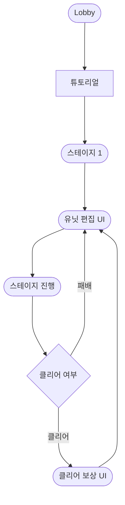

## 1. 현행 버전 회고
 - 탑다운 전략 디펜스이며 핵심 루프는 실시간으로 다가오는 적의 기호를 파악해코스트와 인구수에 유의해
 상성에 맞는 유닛을 선택한 후, 방향키 커맨드를 입력하여 포드를 투하해 제자리 방어선을 구축합니다.
 이 과정을 반복하며 제한 시간 동안 베이스의 체력이 소진되지 않도록 적의 공세를 막아내고
 끝까지 생존하는 것입니다. 제한시간 안에 베이스의 체력이 0이 되면 게임에서 패배하게 됩니다.
 - 핵심 루프 중 적들이 등장해 플레이어의 유닛과 전투하는 부분은 잘 작동을 하였다.
 - ### 1. 게임 내의 전장이 많이 작아서 플레이어가 단조로움을 느끼게 된다
 - ### 2. 플레이어의 유닛과 적의 유닛의 수가 적어 상성 또는 전략을 생각하기에는 부족했다.
 - ### 3. 플레이어의 유닛이 고정되어 있어 앞서 말했듯이 단조로움과 전략적인 부분이 많이 부족했다.
 - ### 4. 게임의 전체적인 효과가 많이 미흡했다. 소리와 전투, 소환 이펙트 등

## 2. 업데이트 목표와 콘셉트
- 게임의 전체적인 볼륨 확장이 목표이다.
- 키워드 3개는 튜토리얼, 스테이지 확장, 유닛 수 확장이다.
- **시스템 기획 요소** :
  - **스테이지 클리어 보상 및 유닛 교환 시스템** : 하나의 스테이지가 끝날 때마다 제시되는 신규 유닛을 보상으로 획득하는 시스템을 추가합니다. 플레이어는 보유할 수 있는 
  유닛 슬롯의 제한 내에서, 새로 획득한 유닛을 기존유닛과 교환하여 다음 스테이지에 진입할 수 있는 `유닛 덱 설정 단계`를 도입합니다.
  이를 통해 단조로웠던 고정 배치 구조에서 탈피하여, 스테이지마다 자신만의 유닛 구성을 가져가는 전략적 재미를 제공합니다.
- **콘텐츠 기획 요소**
    - **튜토리얼 단계 도입** : 게임에 처음 진입한 유저를 위해 가이드라인에 맞추어 유닛을 소환해보는 스테이지를 제공합니다. 자원과 인구수 UI를 하이라이트하여
  소환 조건을 인지 시킨 뒤, 커맨드를 입력해 아군 유닛을 배치하는 시스템을 적응시킵니다. 이후 상성 시스템을 이해시키기 위해 데미지 차이를 직접 체감할 수 있는
  시나리오를 제공합니다.
    - **스테이지 및 몬스터 확장** : 신규 스테이지가 추가되며, 새로운 공격 패턴이나 기호를 가진 신규 적 유닛들(해킹 유닛, 은신 유닛) 추가합니다.
- **UI 기획 요소**
  - **가이드 하이라이트 UI: 튜토리얼 진행 시 화면의 다른 영역은 암전처리 하고, 현재 주목해야 하는 '코스트', '인구수 용량', '커맨드 입력 콘솔'영역만
  밝게 강조하는 연출을 도입합니다.
  - **유닛 편집 UI**: 스테이지가 시작 되기 전에 화면에서 현재 사용중인 유닛과 현재 갖고 있는 유닛 카드를
  드래그 앱 드롭으로 교환 할 수 있는 UI를 제공합니다.
- **피드백 기획 요소**
    - **오디오 및 피드백 보강** : 유닛 선택 시 선택 효과음 제공, 커맨드 입력 효과음, 포드 낙하 시 낙하음과 카메라 쉐이크 추가, 전투 효과음 추가 및
  이펙트 개선합니다.

## 3. UX FLOW

## 4. 화면 기획

