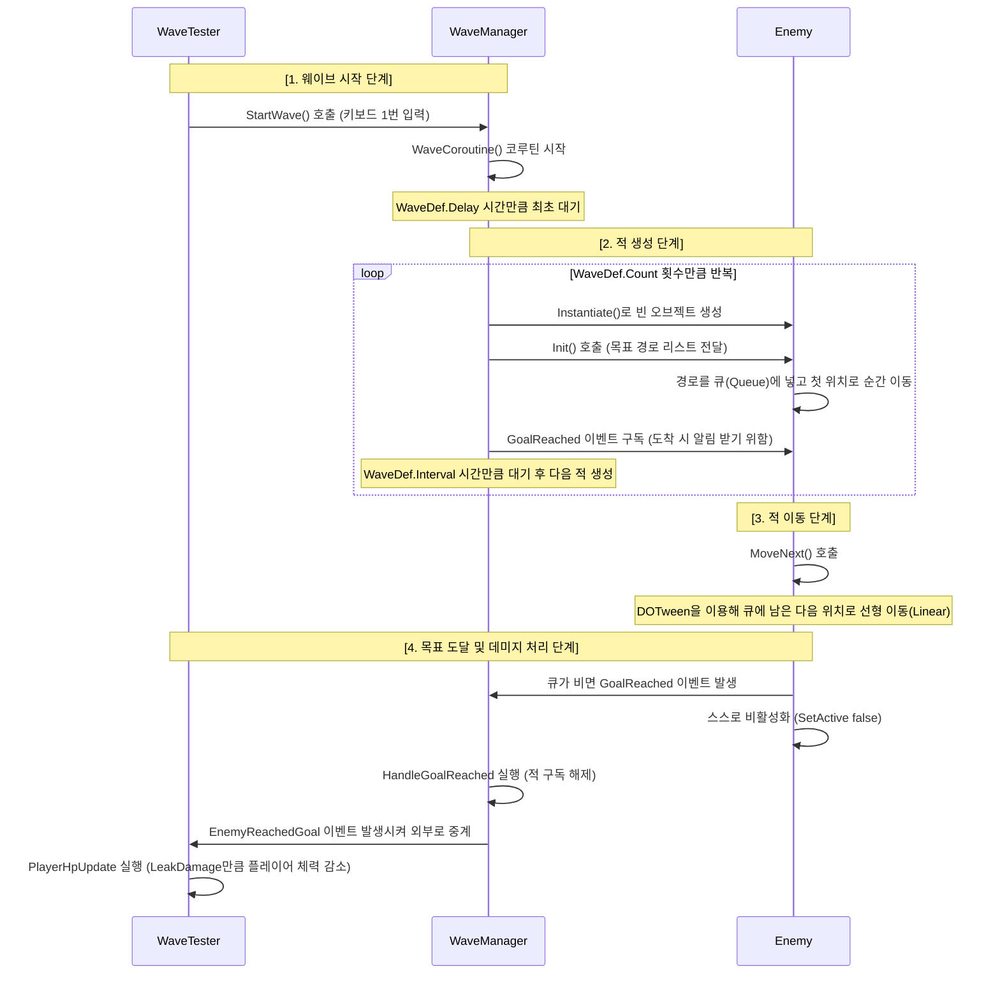

```mermaid
classDiagram
    class WaveTester {
        -int PlayerHp
        -Update()
        -PlayerHpUpdate()
    }
    class WaveManager {
        -WaveDef currentWave
        -MapData currentMap
        +StartWave()
        -SpawnOne()
        -WaveCoroutine()
        -HandleGoalReached()
    }
    class Enemy {
        -Queue~Vector3~ moveQueue
        +Init()
        -MoveNext()
    }
    class WaveDef {
        +EnemyDef Enemy
        +int Count
        +float Interval
        +float Delay
    }
    class EnemyDef {
        +float Speed
        +int LeakDamage
    }

    WaveTester --> WaveManager : 1번 키 입력 시 시작 지시
    WaveManager --> WaveDef : 웨이브 진행에 필요한 정보 참조
    WaveManager --> Enemy : 프리팹 복제 및 초기화 지시
    WaveDef --> EnemyDef : 소환할 적의 기본 데이터 보관
    Enemy --> EnemyDef : 이동 속도 등 자신의 능력치 참조
```

