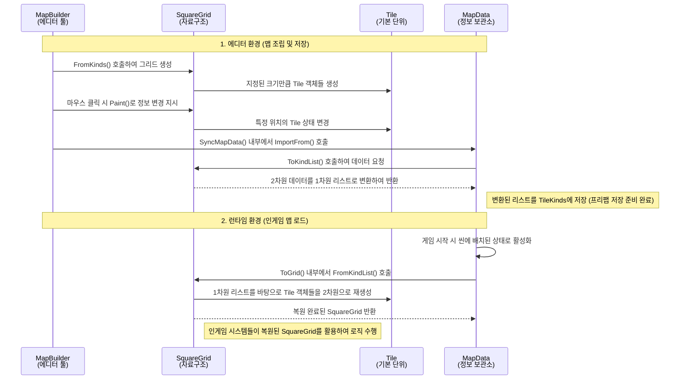

```mermaid
classDiagram
    class MapData {
        +List~TileKind~ TileKinds
        +ImportFrom(SquareGrid grid)
        +ToGrid() SquareGrid
    }
    class SquareGrid {
        -Tile[,] tiles
        +ToKindList() List~TileKind~
        +FromKinds(TileKind[,]) SquareGrid
        +FromKindList(List~TileKind~) SquareGrid
    }
    class Tile {
        +Vector2Int Coord
        +TileKind Kind
        +Unit Unit
        +IsBuildable() bool
    }

    MapData --> SquareGrid : 데이터 추출 및 복원
    SquareGrid "1" *-- "다수" Tile : 2차원 배열로 포함
```

