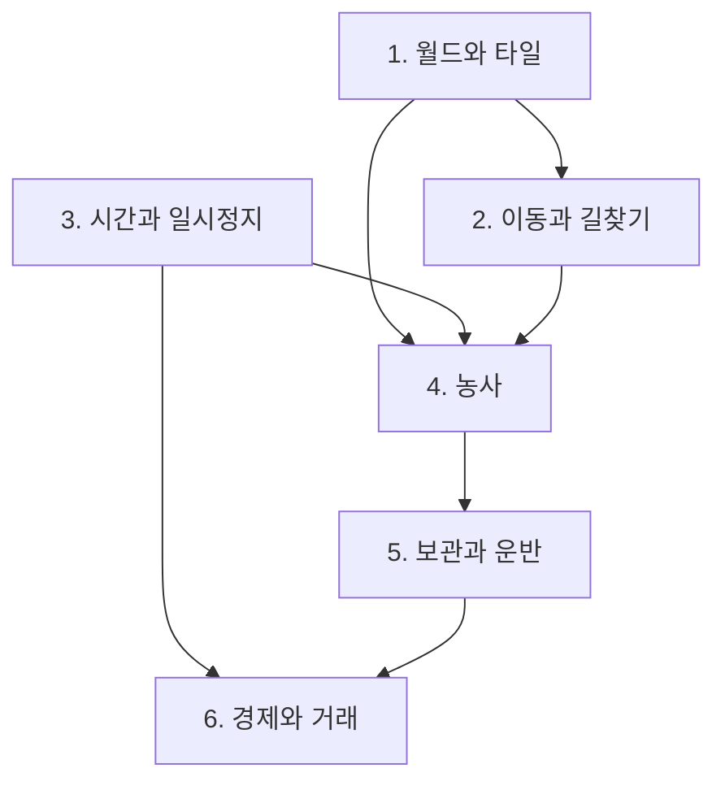

# 미니 팜 — 컨셉 & 시스템 요약 기획서

---

## 1. 개요

| 항목 | 내용 |
|---|---|
| 제목(가제) | 미니 팜 (Mini Farm) |
| 장르 | 2D 탑다운 농사 시뮬레이션 |
| 플랫폼 | PC (Windows) |
| 시점 / 조작 | 탑다운 타일 그리드, 마우스 클릭 중심. 화면은 마우스로 밀어 스크롤 |
| 맵 크기 | 24 x 16칸 (한 화면에 다 보이지 않는다) |
| 테마 | 작은 시골 농장 |
| 한 줄 컨셉 | 시간을 멈춰 계획을 세우고, 클릭 한 번으로 농부를 보내 농장을 굴린다 |

---

## 2. 목표와 승패 조건

- **목표**: 정해진 기간 안에 작물을 길러 팔아 목표 금액을 모은다.
- **승리**: 14일차가 끝나기 전에 소지금이 목표 금액에 도달한다.
- **패배**: 14일차가 끝났는데 목표 금액에 못 미친다.

작물이 시들거나 캐릭터가 죽는 실패는 없다. **시간이 유일한 압박**이다.

---

## 3. 핵심 게임플레이 루프

```
[일시정지] 오늘 할 일을 계획 (경로 미리보기)
  → 재개 → 클릭한 곳으로 농부가 이동(A*)
  → 밭 갈기 → 씨앗 뿌리기 → 물 주기
  → [시간 경과] 작물 성장
  → 수확 → 손에 든 채로 창고까지 운반 → 보관
  → 시세를 보고 상인에게 판매 → 씨앗 구매
  → 하루 종료(정산 · 시세 갱신 · 저장)
  → 다시 계획 …
  → 목표 금액 달성(승리) 또는 14일차 종료(패배)
```

---

## 4. 시스템 지도

| # | 시스템 | 상세 문서 | 코드 폴더 |
|---|---|---|---|
| 1 | 월드와 타일 | [01. 월드와 타일](<02. 시스템 기획서/01. 월드와 타일.md>) | `00. World` |
| 2 | 이동과 길찾기 | [02. 이동과 길찾기](<02. 시스템 기획서/02. 이동과 길찾기.md>) | `01. Movement` |
| 3 | 시간과 일시정지 | [03. 시간과 일시정지](<02. 시스템 기획서/03. 시간과 일시정지.md>) | `02. Time` |
| 4 | 농사 | [04. 농사](<02. 시스템 기획서/04. 농사.md>) | `03. Farming` |
| 5 | 보관과 운반 | [05. 보관과 운반](<02. 시스템 기획서/05. 보관과 운반.md>) | `04. Economy` |
| 6 | 경제와 거래 | [06. 경제와 거래](<02. 시스템 기획서/06. 경제와 거래.md>) | `04. Economy` |

### 의존 관계



---

## 5. 핵심 시스템 요약
상세 내용은 해당 문서 참조

| 시스템 | 핵심 규칙 |
|---|---|
| 월드와 타일 | 타일마다 이동 비용이 다르다. **밭을 갈면 비용이 오른다** |
| 화면 | 농장이 한 화면에 다 안 들어온다. **마우스를 화면 가장자리로 밀어 둘러본다** |
| 이동과 길찾기 | A\* 로 경로를 찾는다. **4방향만, 사선 금지**(애니메이션 제약) |
| 시간과 일시정지 | 게임 시간과 실제 시간은 다른 시계다. **일시정지 중에도 계획할 수 있다** |
| 농사 | **물을 준 날에만 자란다.** 시들지는 않는다 |
| 보관과 운반 | 수확물은 순간이동하지 않는다. **들고 창고까지 걸어간다** |
| 경제와 거래 | 판매가만 시세를 탄다. **씨앗값은 고정** |

---

## 6. 데이터 파일 목록

**모든 수치의 단일 출처는 아래 파일** 기획서에는 예시값만 사용.

| 파일 | 한 행 = | 쓰는 시스템 |
|---|---|---|
| `Table/MiniFarm/tiles.tsv` | 타일 종류 하나 | 월드 · 길찾기 |
| `Table/MiniFarm/crops.tsv` | 작물 한 종류 | 농사 |
| `Table/MiniFarm/items.tsv` | 아이템 한 종류 | 보관 · 경제 |
| `Table/MiniFarm/prices.tsv` | 아이템별 시세 변동 규칙 | 경제 |
| `Table/MiniFarm/config.json` | 게임 전역 설정 | 전부 |
