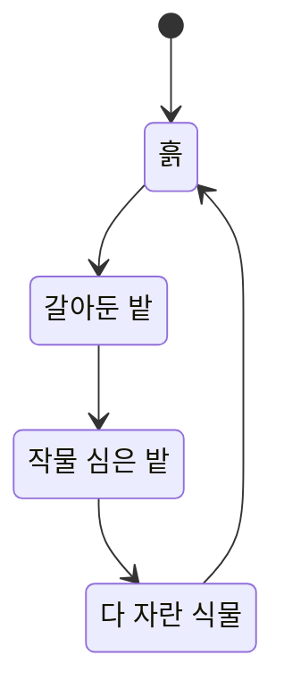

# 월드와 타일 시스템 기획서

---

## 1. 목적

게임이 벌어지는 공간. 
농장은 사각 타일 그리드이고, **타일 하나가 상태를 가진다.**

길찾기는 타일의 **이동 비용**을 읽고, 농사는 타일의 **경작 상태**를 바꾼다.
**두 시스템이 같은 타일을 공유한다는 것이 이 게임 구조의 핵심**.

---

## 2. 용어

| 용어 | 코드 | 뜻                                                          |
|---|---|-------------------------------------------------------------|
| 그리드 | `FarmGrid` | 타일 전체를 담는 2차원 배열                                 |
| 타일 | `Tile` | 칸 하나. 종류, 이동 비용, 경작 상태를 가진다                |
| 좌표 | `Vector2Int Coord` | 그리드 안에서의 위치. 왼쪽 아래가 `(0, 0)`                  |
| 타일 종류 | `TileType` | 길, 흙, 갈아둔 밭, 물, 바위, 울타리                    |
| 놓인 물체 | `MapObjectEntry` | 칸 위에 세워지는 것. 창고, 상점, NPC, 장식               |
| 이동 비용 | `MoveCost` | 이 타일을 밟고 지나갈 때 드는 비용                          |
| 통과 가능 | `IsWalkable` | 지나갈 수 있는가                                            |
| 경작 상태 | `TillState` | 흙 타일이 밭으로 바뀐 정도                                  |
| 가장자리 띠 | `EdgeThickness` | 화면 가장자리에서 스크롤이 시작되는 폭. 화면 크기 대비 비율 |
| 화면 경계 | — | 카메라가 보는 사각형. 맵 밖으로 나가지 않는다               |

---

## 3. 동작 규칙

### 3.1. 타일 종류

| 종류 | 이동 비용 | 통과 | 밭 갈기 | 설명 |
|---|---|---|---|---|
| 길 | 낮음 | O | X | 포장된 길. 가장 빠르다 |
| 흙 | 보통 | O | **O** | 밭을 갈 수 있는 유일한 타일 |
| 갈아둔 밭 | 높음 | O | X | 씨앗을 심을 수 있다. 밟고 지나가기는 느리다 |
| 물 | — | **X** | X | 통과 불가 |
| 바위 · 울타리 | — | **X** | X | 통과 불가 |

### 3.2. 흙 타일의 상태 전이

밭 갈기와 수확이 이 순환을 돌린다.

- **갈아둔 밭은 이동 비용이 흙보다 높다.** 밟고 지나가기 불편해진다
- 수확하면 다시 흙으로 돌아간다. 다시 갈아야 심을 수 있다
- 심긴 밭은 밭 갈기를 다시 할 수 없다

> **이 규칙이 길찾기와 맞물린다.** 밭을 많이 갈수록 그 구역을 가로지르는 비용이 올라가고,
> 경로가 길로 돌아가기 시작한다. 농사 진행이 이동 경로를 바꾼다.

### 3.3. 좌표 규칙

- 왼쪽 아래가 `(0, 0)`, 오른쪽 위로 갈수록 값이 커진다
- 타일 한 칸은 월드에서 1유닛이다.

### 3.4. 카메라와 화면

**마우스로 화면을 민다.**

| 상황 | 결과 |
|---|---|
| 마우스가 화면 가장자리 띠 안으로 들어감 | 그 방향으로 화면이 계속 밀린다 |
| 가장자리에서 벗어남 | 즉시 멈춘다 |
| 화면이 맵 경계에 닿음 | 그 방향으로는 더 밀리지 않는다 |

- **화면은 맵 밖으로 절대 나가지 않는다.** 카메라가 보는 사각형이 맵 안에 갇힌다
- 맵이 화면보다 좁은 축이 있으면 그 축은 밀리지 않고 **가운데 정렬**한다

**일시정지 중에도 화면은 움직인다.**
카메라는 게임 시간이 아니라 실제 시간을 따른다.
멈춰 세워 놓고 농장을 둘러보며 계획하는 것이 이 게임의 컨셉이므로, 여기서 화면이 굳으면 안 된다.

**가장자리를 클릭해도 이동 명령은 정상 동작한다.**
화면이 밀리는 중이라고 클릭을 먹지 않으면 맵 가장자리의 밭을 다룰 수 없게 된다.

---

## 4. 수치

값을 고칠 때는 이 문서가 아니라 표를 고친다. 아래는 열 구성을 보여주는 발췌.

| TileType | Name | MoveCost | Walkable | Tillable |
|---|---|---|---|---|
| Road | 길 | 1 | TRUE | FALSE |
| Soil | 흙 | 2 | TRUE | TRUE |

> 전체 행은 표 파일에 있다. 위 두 행은 형태를 보여주기 위한 예시다.

그리드와 카메라 값은 `config.json` 에 있다.

| 키 | 뜻 | 기준값 |
|---|---|---|
| `GridWidth` · `GridHeight` | 맵 크기(칸) | 24 x 16 |
| `CameraSize` | 카메라 세로 반지름(유닛) | 4 — 세로 8칸이 보인다 |
| `CameraScrollSpeed` | 화면이 밀리는 속도 | |
| `CameraEdgeThickness` | 가장자리 띠 두께 (화면 대비 비율) | |

### 밸런스 의도
- 길과 흙의 비용 차이가 작으면 **길이 무의미**해진다. 두 배 정도 차이를 둔다
- 갈아둔 밭이 너무 비싸면 학생이 밭을 안 갈게 된다. 흙보다 한 단계만 높인다
- 화면에 보이는 범위가 넓을수록 계획이 쉬워진다. **세로 절반 정도**가 적당하다.
  다 보이면 둘러볼 이유가 없고, 너무 좁으면 스크롤만 하다 지친다
- 스크롤이 느리면 답답하고 빠르면 멀미가 난다. 화면 한 폭을 1~2초에 지나는 정도로 맞춘다

---

## 5. 예외와 실패 처리

| 상황 | 처리 |
|---|---|
| 그리드 밖을 클릭 | 아무 일도 하지 않는다 |
| 통과 불가 타일을 클릭 | 이동 불가 피드백을 준다 |
| 길 타일에 밭 갈기 시도 | 갈 수 없다는 피드백을 준다 |
| 마우스가 화면 밖으로 나감 | 스크롤을 멈춘다. 창 밖으로 나간 채 계속 밀리면 안 된다 |
| 맵 경계에서 계속 밀기 | 더 밀리지 않는다. 화면이 흔들리거나 튀지 않게 딱 멈춘다 |

---

## 6. 다른 시스템과의 관계

- **시간과 일시정지** : 게임 시간이 멈춰도 화면은 실제 시간으로 계속 움직여야 한다.
  카메라가 `WorldClock.DeltaTime` 을 쓰면 안 되는 유일한 자리다
- **이동과 길찾기** : 타일의 `MoveCost` 와 `IsWalkable` 을 읽어 경로를 만든다
- **농사** : 흙 타일의 경작 상태를 바꾸고 읽는다
- **보관과 운반** : 맵에 놓인 창고 물체의 자리를 찾는다 (`FindObjects("Storage")`)
- **경제와 거래** : 맵에 놓인 상점 물체의 자리를 찾는다 (`FindObjects("Shop")`)
