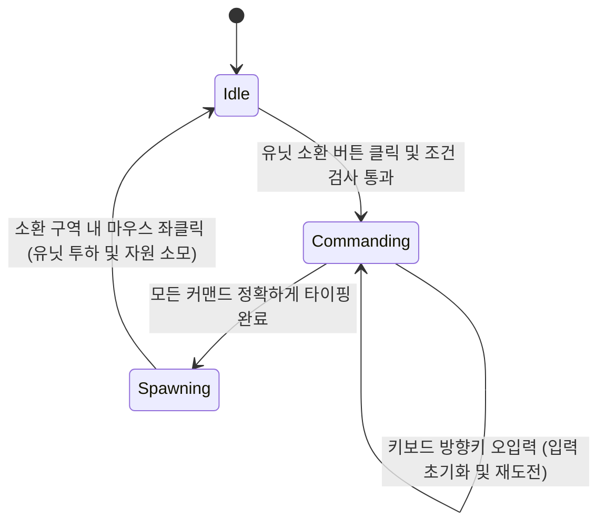
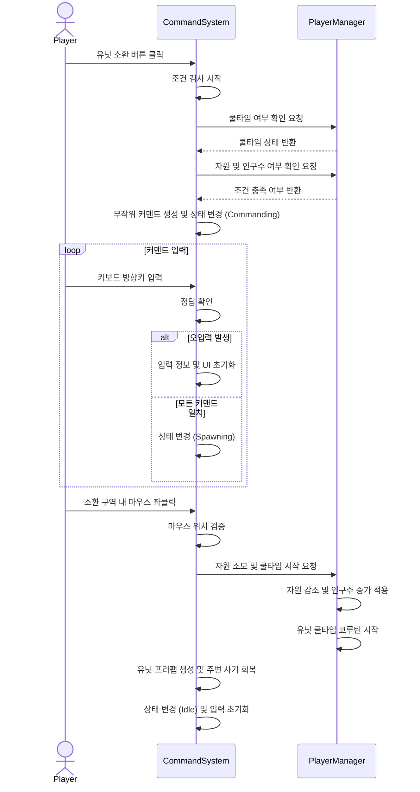
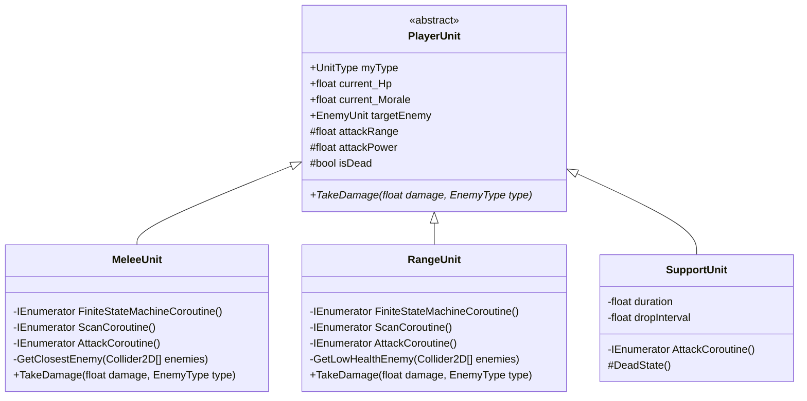
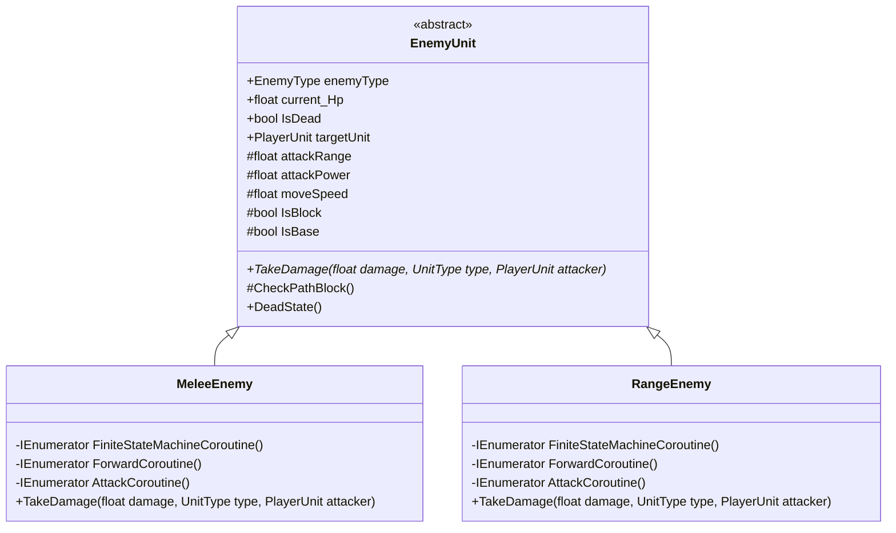
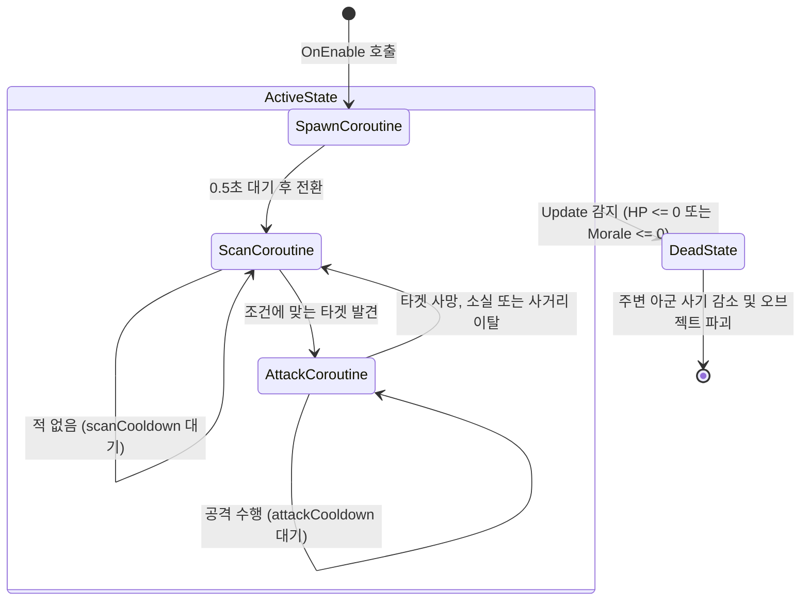
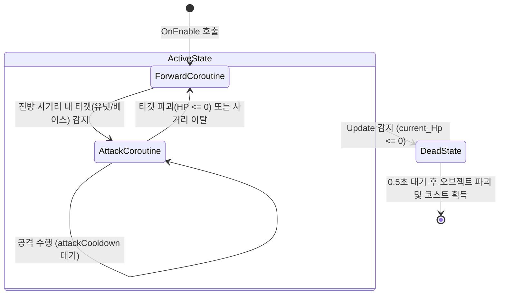
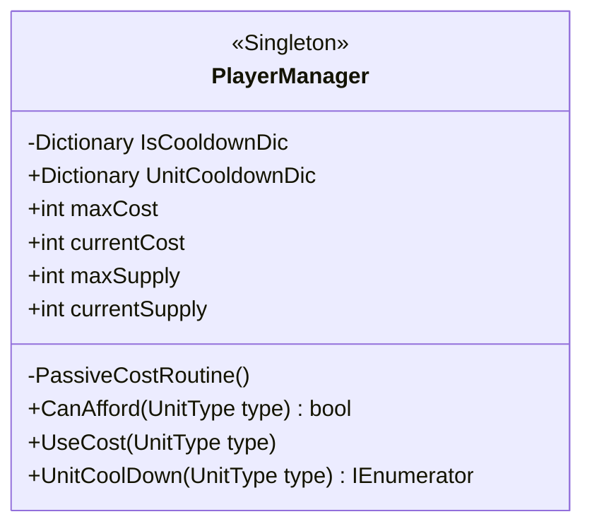
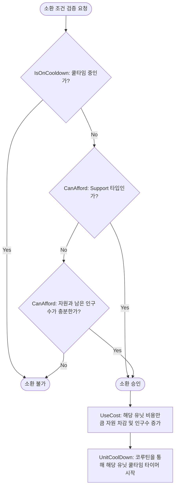

본 프로젝트는 "HellDivers2"의 스트라타젬 시스템에서 영감을 받은 전략 디펜스 게임입니다. 플레이어는 우주선 내부의 중앙 전술 스크린을 제어하는 사령관이 됩니다.
행성의 전황은 세모, 네모, 동그라미 등의 점과 기호로만 표현되는 미니멀리즘 UI로 전달됩니다. 플레이어는 실시간으로 진격해오는 적의 상성을 직관적으로 파악하고, 
상황에 맞는 아군 유닛을 정해 방향키 커맨드를 타이핑하여 최적의 위치에 아군 유닛 포드를 투하해야 합니다. 또는 궤도 폭격 등 공격 지원을 할 수 있습니다.

## 1. 커맨드 시스템
방향키 커맨드 입력 기반 소환 시스템의 핵심 기능과 작동 방식에 대해 설명하겠습니다.
이 시스템은 사용자의 입력을 처리하는 CommandSystem과 인구수, 자원 및 쿨타임을 관리하는 PlayerManager 클래스의 상호작용으로 구현되었습니다.

### 1.1 핵심 기능 개요

### 1. 소환 조건 확인 기능입니다.
- 플레이어가 UI에서 유닛을 클릭하면 먼저 PlayerManager를 통해 해당 유닛의 재사용 대기시간이 끝났는지, 소모할 자원과 남은 인구수가 충분한지 검사합니다.
### 2. 무작위 커맨드 생성 및 입력 검사 기능입니다.
- 조건이 충족되면 CommandSystem에서 유닛의 등급에 비례하는 길이의 무작위 방향키 조합을 생성합니다. 
플레이어의 키보드 입력이 들어올 때마다 정답을 확인하며, 오입력이 발생하면 입력 정보와 UI가 초기화되어 처음부터 다시 타이핑해야 합니다.  
### 3. 위치 지정 및 소환 기능입니다.
- 커맨드를 모두 올바르게 입력하면 디스플레이를 클릭하여 유닛을 투하할 수 있는 상태가 됩니다. 
이때 정해진 소환 구역 안에서만 클릭이 유효하며, 지원 폭격의 경우 마우스 위치를 따라 별도의 반경 범위가 표시됩니다.  
### 4. 자원 소모 및 사기 부여 기능입니다.
- 마우스 클릭으로 배치가 완료되면 유닛의 비용만큼 자원이 감소하고 현재 인구수가 증가하고 쿨타임이 시작됩니다. 
또한 유닛이 낙하한 위치 반경 내에 있는 다른 아군 유닛들의 사기 수치를 회복시키는 효과를 발생시킵니다.  
> 이 시스템을 제작하게 된 이유는 단순히 유닛을 클릭하면 유닛이 즉시 소환되는 일반적인 방식보다 적들이 실시간으로 몰려오는 상황 속에서도,
플레이어는 자원과 쿨타임을 계산하고 오타 없이 조작해 내는 긴장감과 성취감을 주기 위해서입니다.

### 1.2 시스템 구조

- **Idle(대기 상태)** : 플레이어가 UI에서 특정 유닛의 소환 버튼을 클릭했을 때, 자원과 쿨타임 조건이 충족되었다면 초기 커맨드를 생성하고 Commanding 상태로 전환합니다.
- **Commanding(커맨드 대기 및 입력 상태)** : 화면에 무작위 방향키 커맨드가 출력되고 플레이어의 키보드 입력을 실시간으로 검사하는 상태입니다.
플레이어가 방향키를 하나라도 틀리게 입력하면 UI와 입력 리스트가 초기화되지만, 상태 자체는 Commanding으로 유지되어 재도전할 수 있습니다.
- **Spawning(소환 위치 지정 상태)** : 유닛을 전장에 투하하기 위해 마우스로 위치를 지정하는 상태입니다. 지원 폭격일 경우 마우스 커서를 따라 반경이 표시되며,
유효한 소환 구역 내에서 마우스 좌클릭을 하면 유닛이 생성됨과 동시에 시스템은 다시 Idle 상태로 돌아갑니다.



### 1. 소환 요청 및 검증 단계
플레이어가 UI에서 특정 유닛의 소환 버튼을 누르면, 데이터를 관리하는 PlayerManager로 부터 쿨타임과 자원 및 인구수 확인을 요청하고 결과를 반환하면 다음 단계로 넘어갑니다.

### 2. 커맨드 생성 및 확인 루프 단계
조건이 충족됐다는 결과를 받으면 CommandSystem 내부에서 유닛 등급에 맞는 무작위 방향키 커맨드를 생성합니다. 이후 플레이어의 키보드 입력이 들어올 때마다 정답과
대조하여 확인하는 루프가 실행되며, 틀리면 입력 정보와 UI를 초기화하여 처음부터 다시 입력받도록 처리합니다.

### 3. 유닛 투하 및 데이터 갱신 단계
커맨드를 모두 맞춘 플레이어가 화면을 클릭하면, CommandSystem은 마우스 좌표가 유효한 소환 구역인지 확인합니다. 구역이 맞다면 유닛 프리팹을 생성하기 전에 
PlayerManager가 자원 차감과 쿨타임을 시작합니다. 유닛이 전장에 생성되며 주변 아군의 사기를 회복시키고, 시스템은 다시 초기 대기 상태로 돌아갑니다.

### 1.3 핵심 기능 및 사용법

- **사용법** :
외부(예: UI 버튼)에서는 시스템의 내부 상태를 알 필요가 없습니다. 사용자가 특정 유닛의 소환 버튼을 클릭하면, 
UI는 CommandSystem의 OnTriangleClick()과 같은 해당 유닛 지정 함수만 호출하면 됩니다.

```csharp
// UI 스크립트 등 외부에서의 호출 예시
public void OnClickTriangleButton()
{
// CommandSystem에 세모 유닛 소환 로직을 요청합니다.
commandSystem.OnTriangleClick();
}
```
이 함수가 호출되면 CommandSystem 내부에서 스스로 PlayerManager에게 자원과 쿨타임을 물어보고,
조건이 맞으면 무작위 커맨드를 생성한 뒤 상태를 Commanding으로 전환하여 키보드 입력을 기다립니다.

- **핵심 동작**
이 시스템은 플레이어의 키보드 입력을 실시간으로 확인하는 CheckCommand 함수입니다.
```csharp
private void CheckCommand()
{
    // 입력한 방향키가 현재 순서(count)의 정답과 일치하는지 확인합니다.
    if (commandList[count] == InputCommand[count])
    {
        spawnedArrowImages[count].color = Color.green; // 정답 시 UI를 녹색으로 변경하여 시각적 피드백 제공
        count++;
        // 모든 커맨드를 오타 없이 맞췄을 경우
        if (count == commandList.Count)
        {
            count = 0;
            currentState = CommandState.Spawning; // 소환 위치 지정 상태로 전환
        }
    }
    else
    {
        // 핵심 설계: 오입력이 발생했을 때의 처리
        // 유닛 선택은 유지 한채로 커맨드와 UI만 초기화
        commandList.Clear();
        InputCommand.Clear();
        count = 0;

        foreach (Transform child in arrowUI)
        {
            Destroy(child.gameObject);
        }
        spawnedArrowImages.Clear();
    }
}
```

### 1.4 실시간 커맨드 검증 및 실패 처리 방식결정 대상:
> 사용자의 키보드 입력을 어느 타이밍에 검증하고, 오타가 발생했을 때 어떻게 처리할 것인가?

### [대안 A] 입력 완료 후 일괄 검증
- **장점** : 사용자가 입력한 커맨드를 하나의 문자열이나 리스트로 모아두었다가, 마지막 키를 눌렀을 때 한 번만 정답 리스트와 비교하면 되므로 로직이 단순합니다
- **단점**: 플레이어의 피드백이 늦습니다. 중간에 오타를 내더라도 끝까지 입력한 뒤에야 실패를 알게 되어 유저가 상황 판단 할 시간이 줄어듭니다.
### [대안 B] 매 커맨드 입력 시 실시간 인덱스 확인 및 즉시 초기화
- **장점** : 입력이 들어올 때마다 CheckCommand 함수를 호출하여 현재 인덱스(count)를 확인하므로 즉각적인 시각적 피드백이 가능합니다.
틀렸을 경우 시스템 상태는 Commanding으로 유지한 채 입력 리스트와 UI만 지워버립니다.
- **단점** : Update 루프 안에서 매 입력마다 검증 로직이 돌아야 합니다.
### [최종 결정 및 이유]
> 대안 B를 선택했습니다. 플레이어의 빠른 판단이 중요한 게임에서 모든 입력을 하고 나서 피드백이 오는 것은 유저가 납득 하지 못하는 시스템입니다.

### 1.5 결과 및 배운 점

### 결과
- 유닛 선택 시 랜덤으로 커맨드를 배치해 해당 커맨드를 유저가 입력하면 실시간으로 확인하여 정답을 확인하며 피드백을 주는 시스템을 구현했습니다.

### 아쉬운 점
- 현재 CommandSystem 클래스가 많은 책임을 지니고 있습니다. 현재 이 클래스는 사용자의 커맨드 입력과 조건 확인뿐만 아니라, 유닛 프리팹을 직접 할당받아
Instantiate로 생성하는 작업, Physics2D.OverlapBoxAll을 이용해 주변 아군 유닛의 사기(Morale)를 회복시키는 로직까지 
SetSpawnPosition 함수 안에서 모두 처리하고 있습니다.

### 향후 개선 계획
- CommandSystem은 오직 유닛 소환 조건을 확인하고 플레이어의 방향키 입력을 검증하는 책임만 가지도록 리팩토링을 진행하며,
유닛의 Instantiate와 주변 사기 회복 등의 로직은 다른 클래스로 분리할 것입니다.
CommandSystem은 커맨드가 최종 완성되었을 때 해당 스포너에게 좌표와 유닛 타입만 전달하여 소환을 위임하는 방식으로 책임을 나눌 예정입니다.

## 2. 기호 상성 기반 자동 전투 시스템

아군의 제자리 고정 방어와 적군의 베이스 돌격이라는 비대칭적 구도 속에서, 기호 간의 상성에 따라 데미지가 달라지는 자동
전투 시스템에 대해 설명하겠습니다. 이 시스템은 공통 데이터를 가진 PlayerUnit과 EnemyUnit 부모 클래스를 기반으로,
타겟팅 로직과 상성 연산을 구현한 Melee, Range 자식 클래스들의 다형성을 통해 작동합니다.

### 2.1 핵심 기능 개요

### 1. 진영별로 차별화된 타겟 탐색 및 행동 상태(FSM) 기능입니다.
- **적 유닛(EnemyUnit)** : 목표인 베이스를 향해 지속적으로 전진하다가, 자신의 전방 시야각과 사거리 내에
플레이어 유닛이 감지되어 길이 막히면 전진을 멈추고 해당 적을 공격합니다.


- **플레이어 유닛(PlayerUnit)** : 투하된 제자리에 고정되어 주변을 탐색합니다. 근거리 유닛(MeleeUnit)은 사거리 내
가장 가까운 적을, 원거리 유닛(RangeUnit)은 체력이 가장 낮은 적을 우선적으로 타겟팅하여 공격합니다.

### 2. 상성 관계에 따른 데미지 증감 연산 기능입니다.
- 동그라미, 세모, 네모 기호 간의 가위바위보 상성에 따라 데미지가 다르게 적용됩니다. 공격 시 유리한 상성일
경우 2배의 피해를 주며, 피격 시에는 0.5배의 피해만 받습니다. 불리한 상성일 경우에는 반대 수치의 피해를 입습니다.

> 적들은 베이스를 향해 밀려오는데, 플레이어가 배치한 유닛은 스스로 이동하거나 후퇴할 수 없도록 강제하기 위해서입니다.
> 실시간으로 다가오는 적들의 기호를 빠르게 파악하고, 그에 맞는 카운터 상성의 유닛을 적재적소에 배치하여 적의 진격을
> 가로막는 전략적인 판단의 재미를 극대화하기 위해서입니다.

### 2.2 시스템 구조

전투 시스템은 유닛들의 공통 속성을 묶은 부모 클래스와, 탐색 및 상성 로직을 각기 다르게 구현한 자식 클래스 간의 상속 및 다형성을 활용하여 설계되었습니다.

- **PlayerUnit(추상 부모 클래스)** : 모든 플레이어 유닛이 공유하는 체력, 사기(Morale), 사거리, 공격력 등의 기본 데이터를 정의합니다. Update 함수를 통해 
매 프레임 체력 또는 사기 두 수치 중 하나라도 0 이하로 떨어지면 DeadState를 호출하는 공통 생존 관리 로직을 수행합니다. 
- **MeleeUnit(근거리 아군 유닛)** : GetClosestEnemy 메서드를 통해 사거리 내에서 가장 가까운 적을 탐색하여 타겟팅합니다. 
적의 기호(동그라미 ,네모, 세모)에 따라 데미지가 다르게 들어가는 TakeDamage를 오버라이딩합니다.  
- **RangeUnit(원거리 아군 유닛)** : GetLowHealthEnemy 메서드를 사용하여 사거리 내의 적들 중 체력이 가장 낮은 대상을 식별하고 죽을 때까지 점사합니다.
적의 기호(동그라미 ,네모, 세모)에 따라 데미지가 다르게 들어가는 TakeDamage를 오버라이딩합니다.
- **SupportUnit(지원 폭격 유닛)** : 일반적인 유닛들과 달리 탐색(Scan) 코루틴을 거치지 않고, 설정된 지속 시간(duration) 동안 사거리 내에 
데미지를 줍니다. 지속 시간이 만료되면 전투 루프를 종료하고 스스로 파괴되도록 DeadState를 오버라이딩하여 별도의 생존 주기를 가집니다.


- **EnemyUnit(추상 부모 클래스)** : 모든 적 유닛이 공유하는 체력, 이동 속도, 공격력, 사거리 등의 기본 데이터를 정의합니다. 또한, 매 프레임 전방에 
장애물(플레이어 유닛이나 베이스)이 있는지 확인하는 CheckPathBlock() 공통 기능을 제공합니다.
- **MeleeEnemy(근거리 적 유닛)** : 타겟에게 직접 데미지를 입히는 AttackCoroutine()을 가집니다.
  적의 기호(동그라미 ,네모, 세모)에 따라 데미지가 다르게 들어가는 TakeDamage를 오버라이딩합니다.
- **RangeEnemy(원거리 적 유닛** ): 투사체를 발사하는 방식의 AttackCoroutine()을 가집니다.
적의 기호(동그라미 ,네모, 세모)에 따라 데미지가 다르게 들어가는 TakeDamage를 오버라이딩합니다.

### 상태 머신 흐름도 : PlayerUnit

- **SpawnCoroutine(소환 대기 상태)** : 유닛이 활성화(OnEnable)될 때 먼저 진입하는 상태입니다. 0.5초 동안 대기한 후 포드 이미지를 끄고 유닛의 실제 렌더러를 켠 뒤,
탐색 상태인 ScanCoroutine으로 전환합니다.
- **ScanCoroutine(탐색 상태)** : Physics2D.OverlapCircleAll을 이용해 사거리(attackRange) 내의 적을 탐색하는 상태입니다. MeleeUnit은
거리가 가장 가까운 적을, RangeUnit은 체력이 가장 낮은 적을 타겟으로 지정한 후 AttackCoroutine으로 넘어갑니다. 적이 발견되지 않으면 scanCooldown
시간만큼 대기한 후 탐색을 다시 반복합니다.  
- **AttackCoroutine(공격 상태)** : 타겟이 유효한지 지속적으로 검증하며 공격을 수행합니다. 타겟이 파괴되었거나, 사거리를 벗어났거나, 체력이 0 이하가 되면 
즉시 공격 루프를 빠져나와 ScanCoroutine으로 되돌아갑니다. 타겟이 유효하다면 설정된 딜레이와 쿨타임에 맞춰 타겟에게 데미지를 가합니다.
- **DeadState(사망 상태)** : 유닛이 어떤 코루틴 상태에 있든 상관없이, PlayerUnit의 Update 함수에서 체력(current_Hp)이나
사기(current_Morale)가 0 이하로 떨어지면 작동중인 모든 코루틴을 정지시키고 진입합니다. 진입 후 0.3초 대기 후 반경 2f 내에 있는 다른 아군 
유닛들의 사기를 감소시키고, PlayerManager의 Dead 함수를 호출하여 자신을 파괴합니다.
SupportUnit의 경우 전투 루프 없이 지정된 시간(duration)이 만료되면 스스로 사망 상태로 전환됩니다.

### 상태 머신 흐름도 : EnemyUnit

- **ForwardCoroutine(전진 상태)** : 적 유닛이 활성화(OnEnable)될 때 먼저 진입하는 기본 상태입니다. 플레이어의 베이스(playerBase) 
위치를 향해 설정된 이동 속도(moveSpeed)로 지속해서 전진합니다. 이동하는 동안 매 프레임 CheckPathBlock 함수를 호출하여 전방 시야각(viewAngle)과
사거리(attackRange) 내에 플레이어 유닛이나 베이스가 있는지 탐색합니다. 타겟이 감지되어 IsBlock 또는 IsBase가 참(true)이 되면 즉시 전진을 멈추고 
AttackCoroutine으로 전환합니다.  
- **AttackCoroutine(공격 상태)** :전진을 가로막는 타겟(유닛 또는 베이스)이 유효한지 지속해서 검증하며 공격을 수행하는 상태입니다.
타겟의 체력이 0 이하가 되어 파괴되었거나, 유닛의 사거리 밖으로 벗어났을 경우 즉시 공격 루프를 빠져나와 ForwardCoroutine으로 되돌아가 다시 전진을 시작합니다.
타겟이 유효하다면 설정된 딜레이(attackDelay)와 쿨타임(attackCooldown)에 맞춰 데미지를 가합니다. 
- **DeadState(사망 상태)** : 유닛이 전진이나 공격 코루틴을 수행하는 중이더라도, Update 함수에서 체력(current_Hp)이 0 이하로 떨어지면
즉시 코루틴을 정지(StopAllCoroutines)하고 진입합니다. 사망 시 플레이어에게 정해진 보상(reward)을 지급하고, 유닛의 렌더러를 투명하게 만든 뒤 
사망 이펙트용 오브젝트(deadState)를 활성화합니다. 이후 EnemyDeadState 스크립트에서 0.5초를 대기한 후 PlayerManager의 Dead 함수를 호출하여 
최종적으로 유닛을 파괴합니다.

### 2.3 핵심 기능 및 사용법 (PlayerUnit)

- **사용법** : PlayerUnit은 전장에 소환되는 즉시 내부의 코루틴 상태 머신에 의해 자율적으로 주변을 탐색하고 전투를 수행합니다.
따라서 외부 시스템(예: CommandSystem)에서 유닛의 행동을 일일이 제어하는 메서드는 존재하지 않으며, 오직 적 유닛(EnemyUnit)이 
아군을 타격할 때 호출하는 데미지 전달 함수만이 외부와 연결됩니다.

```csharp
// 부모 클래스인 PlayerUnit의 데미지 처리 메서드
// 외부(적 유닛)에서는 이 함수만 호출하며, 실제 상성 연산은 자식 클래스가 알아서 처리합니다.
public virtual void TakeDamage(float damage, EnemyUnit.EnemyType type)
{
}

```
- **핵심 동작 1** : 다형성을 활용한 차별화된 타겟팅 로직
근거리 유닛과 원거리 유닛은 동일한 탐색 주기(ScanCoroutine)를 가지지만, 타겟을 선정하는 기준이 다릅니다.
다음은 근거리 유닛(MeleeUnit)이 사거리 내에서 자신과 가장 가까운 적을 찾아내는 핵심 알고리즘입니다.

```csharp
private EnemyUnit GetClosestEnemy(Collider2D[] enemies)
{
    Transform closestEnemy = null;
    float closestDistance = Mathf.Infinity;
    Vector3 currentPosition = transform.position;

    foreach (Collider2D enemy in enemies)
    {
        EnemyUnit enemyComponent = enemy.GetComponent<EnemyUnit>();

        // 체력이 0보다 큰 살아있는 적만 탐색 대상으로 한정
        if(enemyComponent != null && enemyComponent.current_Hp > 0)
        {
            // 핵심 설계: 중심점이 아닌, 유닛의 가장 외곽(Edge)을 기준으로 거리를 측정
            Vector3 closet = enemy.ClosestPoint(currentPosition);
            float distanceTo = Vector3.Distance(currentPosition, closet);

            if(distanceTo < closestDistance)
            {
                closestDistance = distanceTo;
                closestEnemy = enemy.transform;
            }
        }
    }
    return closestEnemy != null ? closestEnemy.GetComponent<EnemyUnit>() : null;
}

```

- **핵심 동작 2** : 기호 상성에 따른 데미지 연산 분리
각 유닛은 자신이 가진 기호에 따라 서로 다른 상성 데미지를 주고받습니다. 다음은 동그라미와 네모 기호를 담당하는 MeleeUnit의 피격 로직입니다.

```csharp
public override void TakeDamage(float damage, EnemyUnit.EnemyType type)
{
    float addDamage = 1.0f;
    float moraleDamage = 5.0f;
    
    // 내 기호가 '동그라미'일 때의 상성 판정
    if (myType == PlayerManager.UnitType.Circle)
    {
        if (type == EnemyType.Square) addDamage = 0.5f; // 네모에게 피격 시 데미지 반감
        else if (type == EnemyType.Triangle) addDamage = 2.0f; // 세모에게 피격 시 데미지 2배
    }
    // 내 기호가 '네모'일 때의 상성 판정
    else if (myType == PlayerManager.UnitType.Square)
    {
        if (type == EnemyType.Triangle) addDamage = 2.0f;
        else if (type == EnemyType.Circle) addDamage = 0.5f;
    }
    
    current_Hp -= damage * addDamage;
    current_Morale -= moraleDamage * addDamage;
}
```

### 2.4 핵심 기능 및 사용법 (EnemyUnit)

- **사용법** :적 유닛은 전장에 생성(OnEnable)됨과 동시에 내부의 코루틴 상태 머신을 가동하여 스스로 움직입니다.

- **핵심 동작 1** : 적 유닛의 기본 행동인 전진 로직입니다. 매 프레임 플레이어의 베이스 위치를 향해 이동하며, 이동과 동시에 전방에 방해물이 있는지 지속해서 검사합니다.

```csharp
// 매 프레임 전방에 타겟이 있는지 검사합니다.
CheckPathBlock();
        
// 방해물(유닛 또는 베이스)이 감지되면 전진을 멈추고 공격 코루틴으로 상태를 전환합니다.
if (IsBlock || IsBase)
{
    nextStateCoroutine = AttackCoroutine();
    yield break;
}

```

- **핵심 동작 2** : 부모 클래스인 EnemyUnit에 구현된 공통 탐색 기능입니다. 단순히 사거리 안에 들어왔다고 무조건 
공격하는 것이 아니라, 유닛이 바라보는 전방 시야각(viewAngle) 내에 있는 대상만을 필터링하여 타겟팅합니다.

```csharp
protected void CheckPathBlock()
{
    if (IsBlock == true || IsBase == true) return;
    
    // 1. 사거리(attackRange) 반경 내의 모든 콜라이더를 수집합니다.
    Collider2D[] hits = Physics2D.OverlapCircleAll(transform.position, attackRange);
    Vector3 forwardDir = (playerBase.transform.position - transform.position).normalized;

    foreach (Collider2D hit in hits)
    {
        // 다른 적 유닛은 탐색 대상에서 제외합니다.
        if (hit.GetComponent<EnemyUnit>()) continue;
        
        Vector3 dirToTarget = (hit.transform.position - transform.position).normalized;
        
        // 2. 핵심 설계: 사거리 안에 있더라도, 전방 시야각(viewAngle) 내에 위치하는지 각도를 계산하여 판별합니다.
        if (Vector3.Angle(forwardDir, dirToTarget) < viewAngle / 2)
        {
            if (hit.GetComponent<PlayerUnit>())
            {
                IsBlock = true;
                targetUnit = hit.GetComponent<PlayerUnit>();
                return;
            }
            else if (hit.GetComponent<Base>())
            {
                IsBase = true;
                return;
            }
        }
    }
}
```
### 2.5 거리 계산과 탐지 영역의 기준 불일치 문제 해결
> 유닛이 주변의 적을 탐색하고 공격 가능 여부를 판단할 때, 어떤 연산을 사용할 것인가?

- **[문제 상황]**
초기 개발 단계에서는 적을 탐지할 때는 `Physics2D.OverlapCircleAll`을 사용하고, 실제 공격이 가능한 거리인지 판단할 때는 타겟과의 중심점 거리를 수학적으로 계산하는
`Vector3.Distance`를 사용했습니다. 이로 인해 큰 유닛의 경우, 외곽(Collider)은 탐지 영역(`OverlapCircleAll`) 안에 들어왔음에도 
불구하고 두 유닛의 중심점 간의 거리(`Vector3.Distance`)는 공격 사거리보다 멀게 계산되어, 적을 인지해 놓고도 공격은 하지 않고 가만히 서 있는 버그가 발생했습니다.

### [대안 A] 모든 유닛을 순회하며 순수 수학 연산(Vector3.Distance)만으로 거리 계산
- **장점** : 물리 엔진을 호출하지 않으므로, 유닛의 수가 적을 때는 직관적이고 연산이 가벼울 수 있습니다.
- **단점** : 씬에 존재하는 모든 유닛을 매 프레임 혹은 매 스캔 주기마다 하나씩 `for`문으로 돌며 거리를 재야 합니다.
또한 중심점 기준이므로 유닛의 크기(Scale)가 커질수록 실제 타격 판정(눈에 보이는 모델링 끝부분)과 괴리가 생깁니다.

### [대안 B] Physics2D.OverlapCircleAll과 Collider.ClosestPoint 조합

- **장점** : `OverlapCircleAll`에 `LayerMask`를 적용하면 탐지 범위 내의 적(또는 아군)만 걸러냅니다. `ClosestPoint`를 함께 쓰면 중심점이 아닌 유닛의 
실제 외곽선(Edge)을 기준으로 정확하게 거리를 잴 수 있습니다.
- **단점** : 유닛마다 반드시 `Collider2D` 컴포넌트가 부착되어 있어야 하며, 물리 연산을 사용하므로 연산이 무거울수 있다.

### [최종 결정 및 이유]
- 대안 B를 선택했습니다. 매번 `Vector3.Distance`로 모든 객체를 순회하는 방식은 비효율적인 방식이라고 생각을 했습니다. 유니티가 제공하는 `OverlapCircleAll`와
`LayerMask`를 활용하고, 공격 사거리 판정 역시 `Collider2D.ClosestPoint`를 도입하여 '외곽선 기준'으로 통일함으로써, 
눈에 보이는 거리와 실제 판정이 어긋나는 버그를 해결했습니다.

### 2.6 결과 및 배운 점

### 결과
- 아군의 제자리 방어와 적군의 돌격이라는 비대칭적 구도 속에서, 각 유닛이 기호 상성과 고유의 탐색 방식에 맞춰 자율적으로 교전을 수행하는 자동
전투 시스템을 성공적으로 구축했습니다.

### 아쉬운 점
- 기능 구현을 우선하다 보니 클래스 간의 중복 코드와 역할의 혼재가 발생했습니다.

- **상태 머신 코드의 중복** : `MeleeUnit`과 `RangeUnit`의 코루틴 상태 머신 흐름(Spawn → Scan → Attack)이 완전히 동일하며, 
오직 타겟을 찾는 기준(`GetClosestEnemy`, `GetLowHealthEnemy`)만 다릅니다.

- **분산된 전투 및 사기 처리 로직** : 데미지 증감 연산(`TakeDamage`)과 사기(Morale) 감소 로직이 각 유닛 클래스 내부에 개별적으로 흩어져 있습니다. 
이로 인해 다수의 적을 동시에 타격하는 `SupportUnit`을 추가하거나 사망 시 주변 아군의 사기를 연쇄적으로 깎는 로직을 다룰 때, 
객체 간의 참조가 얽히면서 구조가 매우 복잡해지는 한계를 겪었습니다.

### 향후 개선 계획
- 발견한 기술 부채를 해결하고 시각적 완성도를 높이기 위해 다음과 같은 리팩토링을 계획하고 있습니다.
- **전투 매니저(Combat Manager) 도입** : 각 유닛은 "누구를 공격했다"는 데이터만 전달하고, 실제 상성 데미지 계산, 광역(AoE) 피해 연산, 사기 수치 변동 등 
복잡한 판정을 수행하는 전담 매니저 클래스를 만들 예정입니다. 이를 통해 유닛 클래스의 책임을 줄이고 버그 발생 확률을 낮추겠습니다.
- **코드 리팩토링** : 자식 클래스들에 중복되어 있는 탐색/공격 코루틴 흐름을 부모 클래스(`PlayerUnit`)로 통합하겠습니다.
타겟팅 알고리즘 부분만 인터페이스화하는 방식으로 변경해 코드의 재사용성을 높일 것입니다.
- **DoTween을 활용한 연출** : 현재 `WaitForSeconds`에 의존하여 단순히 오브젝트를 끄고 켜는 연출을 개선하겠습니다. 최근 사용법을 
익힌 `DoTween` 에셋을 도입하여 포드 낙하 텐션, 피격 피드백, 유닛 사망 효과 등을 다듬어 시각적인 재미를 끌어올릴 계획입니다.

## 3. 자원, 인구수 쿨타임 시스템
플레이어의 유닛 소환을 통제하는 자원(Cost), 인구수(Supply), 재사용 대기시간(Cooldown) 통합 관리 시스템에 대해 설명하겠습니다.
PlayerManager 클래스를 싱글톤 패턴으로 구현하여 게임 내 경제와 제약 조건을 중앙에서 통제합니다.

### 3.1 핵심 기능 개요
### 1.소환 검증 및 자원 소모 기능입니다.
- 소환 요청 시 현재 자원과 남은 인구수가 해당 유닛의 요구치 이상인지 판별하고, 소환이 확정되면 비용만큼 자원을 차감한 뒤 인구수를 증가시킵니다.
### 2. 개별 재사용 대기시간 제어 기능입니다. 
- 유닛이 전장에 배치되면 코루틴을 통해 해당 병종 전용 쿨타임을 작동시키며, 타이머가 끝날 때까지 동일 유닛의 연속 소환을 차단합니다.
### 3. 자원 자동 회복 및 인구수 반환 기능입니다. 
- 1초마다 일정량의 자원이 자동으로 충전되며, 전장의 아군 유닛이 파괴될 경우 해당 유닛이 차지하던 인구수를 즉각 반환하여 
다음 소환을 준비할 수 있게 합니다.

> 자원, 인구수, 쿨타임이 결합된 다중 제한 시스템을 기획했습니다. 특정 유닛 하나만 소환하는 단순한 물량 공세를 시스템적으로 차단하기 위해서입니다.
> 한정된 용량과 천천히 차오르는 자원 속에서, 지금 당장 어떤 상성의 유닛이 필요한지 우선순위를 정하고 쿨타임을 계산하여 
> 최적의 타이밍에 배치하는 자원 관리의 전술적 재미를 플레이어에게 제공하기 위해서입니다.

### 3.2 시스템 구조

PlayerManager는 게임 내 경제와 제약 조건을 총괄하는 싱글톤(Singleton) 객체로 설계되었습니다.
다른 클래스(예: CommandSystem, PlayerUnit)들은 PlayerManager의 인스턴스를 통해 자원 상태를 묻거나 갱신을 요청합니다.


- **데이터 보관**: 최대/현재 자원 및 인구수 데이터를 속성(Property)으로 캡슐화하여 보관합니다. 각 유닛 타입별 쿨타임 진행 상태는 `Dictionary`를
활용해 개별적으로 추적합니다.
- **중앙 통제**: 외부에서 자원을 깎을 수 없으며, `CanAfford`로 허가를 받고 `UseCost`를 호출해야만 자원 차감과 쿨타임 시작이 
동시에 안전하게 처리되도록 구조화했습니다.


- **1단계 (쿨타임 검사)**: 가장 먼저 딕셔너리에 저장된 해당 유닛의 쿨타임 상태(`IsCooldownDic`)를 확인하여, 대기 시간 중이면 거부합니다.
- **2단계 (예외 및 자원/인구 검사)**: 쿨타임이 돌고 있지 않다면 `CanAfford`를 호출합니다. 이때 `Support` 유닛은 인구수를 차지하지 않는 
예외 처리를 거쳐 통과되며, 일반 유닛은 현재 자원(`currentCost`)과 남은 인구수(`maxSupply - currentSupply`)가 요구량을 충족해야만 통과됩니다.
- **3단계 (소모 및 갱신)**: 모든 검증을 통과해 배치가 확정되면 `UseCost`가 호출되어 자원과 인구수를 갱신하고,
해당 유닛의 쿨타임 코루틴(`UnitCoolDown`)을 독립적으로 실행시킵니다.

### 3.3 핵심 기능 및 사용법

- **사용법** : PlayerManager는 싱글톤 패턴으로 구현되어 있어 외부 시스템에서 전역적으로 접근할 수 있습니다. 입력을 담당하는 CommandSystem 등 
외부 클래스는 내부 자원 계산식을 알 필요 없이, 검증 함수와 소비 함수만 호출하여 시스템을 제어합니다.

```csharp
// 소환 버튼 클릭 시: 쿨타임과 자원 여부만 먼저 확인
if (PlayerManager.Instance.IsOnCooldown(spawnType)) return;
if (PlayerManager.Instance.CanAfford(spawnType) == false) return;

// ... 플레이어의 커맨드 타이핑 및 위치 지정 완료 후 ...

// 최종 소환 시: 자원 차감 및 쿨타임 시작 요청
PlayerManager.Instance.UseCost(unitType);

```

- **핵심 동작 1** : 이 시스템은 자원이 충분한지 묻는 로직(CanAfford)과 실제로 자원을 깎는 로직(UseCost)을 나누어 설계했습니다.

```csharp
public bool CanAfford(UnitType type)
{
    // 예외 처리: 지원 폭격(Support)은 인구수 제약을 무시하고 즉시 통과
    if (type == UnitType.Support) return true; 
    
    // 현재 자원과 남은 인구수(최대 인구수 - 현재 인구수)가 모두 요구치 이상인지 검사
    if (currentCost >= GetCost(type) && (maxSupply - currentSupply) >= GetSupply(type)) return true;
    return false;
}

public void UseCost(UnitType type)
{
    if (CanAfford(type))
    {
        currentSupply += GetSupply(type);
        currentCost -= GetCost(type);
        StartCoroutine(UnitCoolDown(type));
    }
}

```
- **핵심 동작 2** : 유닛별 쿨타임을 관리하기 위해 상태 제어용 딕셔너리와 UI 연동용 딕셔너리 두 개를 활용했습니다.

```csharp
public IEnumerator UnitCoolDown(UnitType type)
{
    IsCooldownDic[type] = true; // 해당 유닛의 소환 잠금
    float cooldownSec = ... // 유닛별 쿨타임 시간 할당
    float currentTime = 0f;

    while (true)
    {
        if (currentTime >= cooldownSec) break;
        currentTime += Time.deltaTime;
        
        // 외부 UI에서 진행률 바를 그릴 수 있도록 0~1 사이의 값으로 정규화하여 갱신
        UnitCooldownDic[type] = currentTime / cooldownSec; 
        yield return null;
    }
    IsCooldownDic[type] = false; // 쿨타임 종료 및 잠금 해제
    UnitCooldownDic[type] = 1f;
}

```
### 3.4 개별 쿨타임 관리 및 확인
- **[문제 상황] CommandSystem에서 유닛 소환을 요청할 때 해당 유닛의 쿨타임이 다 찼는지 아닌지 판단하는 로직을 어떻게 구현할 것이고, 쿨타임 진행 상황을
UI로 어떻게 내보낼 것인지 고민을 했습니다.

### Dictionary를 사용해 