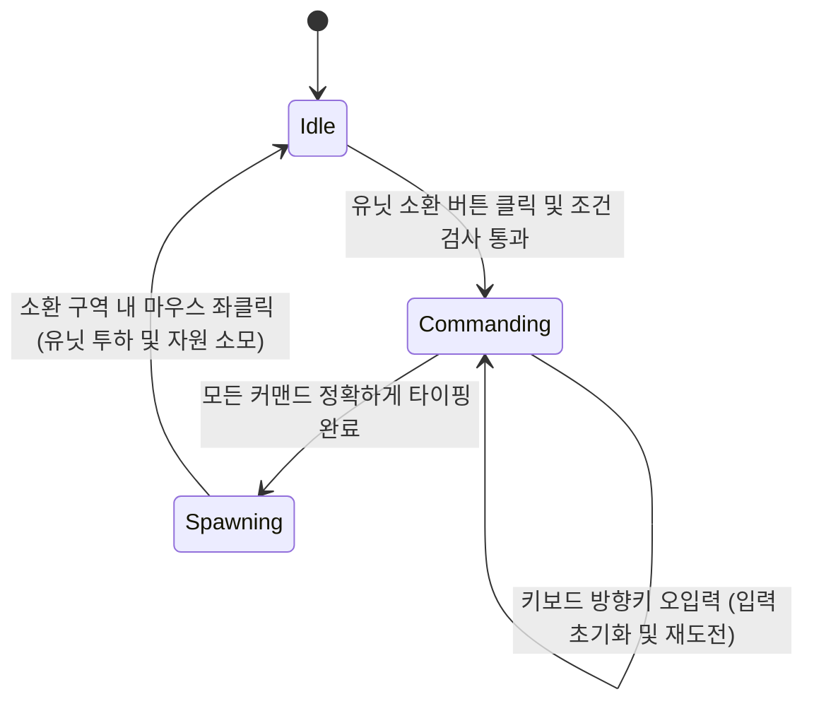
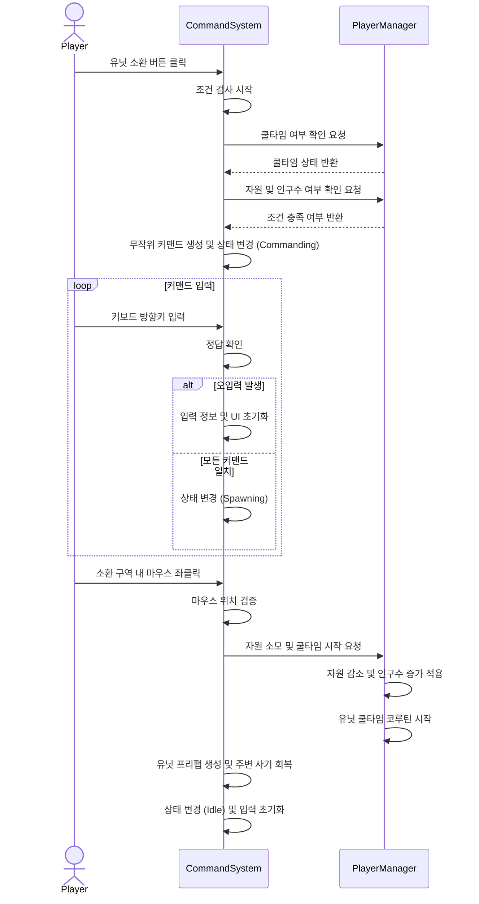

본 프로젝트는 "HellDivers2"의 스트라타젬 시스템에서 영감을 받은 전략 디펜스 게임입니다. 플레이어는 우주선 내부의 중앙 전술 스크린을 제어하는 사령관이 됩니다.
행성의 전황은 세모, 네모, 동그라미 등의 점과 기호로만 표현되는 미니멀리즘 UI로 전달됩니다. 플레이어는 실시간으로 진격해오는 적의 상성을 직관적으로 파악하고, 
상황에 맞는 아군 유닛을 정해 방향키 커맨드를 타이핑하여 최적의 위치에 아군 유닛 포드를 투하해야 합니다. 또는 궤도 폭격 등 공격 지원을 할 수 있습니다.

## 1. 커맨드 시스탬
방향키 커맨드 입력 기반 소환 시스템의 핵심 기능과 작동 방식에 대해 설명하겠습니다.
이 시스템은 사용자의 입력을 처리하는 CommandSystem과 인구수, 자원 및 쿨타임을 관리하는 PlayerManager 클래스의 상호작용으로 구현되었습니다.

### 1.1 핵심 기능 개요

### 1. 소환 조건 확인 기능입니다.
- 플레이어가 UI에서 유닛을 클릭하면 먼저 PlayerManager를 통해 해당 유닛의 재사용 대기시간이 끝났는지, 소모할 자원과 남은 인구수가 충분한지 검사합니다.
### 2. 무작위 커맨드 생성 및 입력 검사 기능입니다.
- 조건이 충족되면 CommandSystem에서 유닛의 등급에 비례하는 길이의 무작위 방향키 조합을 생성합니다. 
플레이어의 키보드 입력이 들어올 때마다 정답을 확인하며, 오입력이 발생하면 입력 정보와 UI가 초기화되어 처음부터 다시 타이핑해야 합니다.  
### 3. 위치 지정 및 소환 기능입니다.
- 커맨드를 모두 올바르게 입력하면 디스플레이를 클릭하여 유닛을 투하할 수 있는 상태가 됩니다. 
이때 정해진 소환 구역 안에서만 클릭이 유효하며, 지원 폭격의 경우 마우스 위치를 따라 별도의 반경 범위가 표시됩니다.  
### 4. 자원 소모 및 사기 부여 기능입니다.
- 마우스 클릭으로 배치가 완료되면 유닛의 비용만큼 자원이 감소하고 현재 인구수가 증가하고 쿨타임이 시작됩니다. 
또한 유닛이 낙하한 위치 반경 내에 있는 다른 아군 유닛들의 사기 수치를 회복시키는 부가 효과를 발생시킵니다.  
> 이 시스템을 제작하게 된 이유는 단순히 유닛을 클릭하면 유닛이 즉시 소환되는 일반적인 방식보다 적들이 실시간으로 몰려오는 급박한 상황 속에서도,
플레이어가 침착하게 자원과 쿨타임을 계산하고 오타 없이 조작해 내는 긴장감과 성취감을 주기 위해서입니다.

### 1.2 시스템 구조

- **Idle(대기 상태)** : 플레이어가 UI에서 특정 유닛의 소환 버튼을 클릭했을 때, 자원과 쿨타임 조건이 충족되었다면 초기 커맨드를 생성하고 Commanding 상태로 전환합니다.
- **Commanding(커맨드 대기 및 입력 상태)** : 화면에 무작위 방향키 커맨드가 출력되고 플레이어의 키보드 입력을 실시간으로 검사하는 상태입니다.
플레이어가 방향키를 하나라도 틀리게 입력하면 UI와 입력 리스트가 초기화되지만, 상태 자체는 Commanding으로 유지되어 재도전할 수 있습니다.
- **Spawning(소환 위치 지정 상태)** : 유닛을 전장에 투하하기 위해 마우스로 위치를 지정하는 상태입니다. 지원 폭격일 경우 마우스 커서를 따라 반경이 표시되며,
유효한 소환 구역 내에서 마우스 좌클릭을 하면 유닛이 생성됨과 동시에 시스템은 다시 Idle 상태로 돌아갑니다.



### 1. 소환 요청 및 검증 단계
플레이어가 UI에서 특정 유닛의 소환 버튼을 누르면, 데이터를 관리하는 PlayerManager로 부터 쿨타임과 자원 및 인구수 확인을 요청하고 결과를 반환하면 다음 단계로 넘어갑니다.

### 2. 커맨드 생성 및 확인 루프 단계
조건이 충족됐다는 결과를 받으면 CommandSystem 내부에서 유닛 등급에 맞는 무작위 방향키 커맨드를 생성합니다. 이후 플레이어의 키보드 입력이 들어올 때마다 정답과
확인하는 루프가 실행되며, 틀리면 입력 정보와 UI를 초기화하여 처음부터 다시 입력받도록 처리합니다.

### 3. 유닛 투하 및 데이터 갱신 단계
커맨드를 모두 맞춘 플레이어가 화면을 클릭하면, CommandSystem은 마우스 좌표가 유효한 소환 구역인지 확인합니다. 구역이 맞다면 유닛 프리팹을 생성하기 전에 
PlayerManager가 자원 차감과 쿨타임을 시작합니다. 유닛이 전장에 생성되며 주변 아군의 사기를 회복시키고, 시스템은 다시 초기 대기 상태로 돌아갑니다.

### 1.3 핵심 기능 및 사용법

- **사용법** :
외부(예: UI 버튼)에서는 시스템의 내부 상태를 알 필요가 없습니다. 사용자가 특정 유닛의 소환 버튼을 클릭하면, 
UI는 CommandSystem의 OnTriangleClick()과 같은 해당 유닛 지정 함수만 호출하면 됩니다.

```csharp
// UI 스크립트 등 외부에서의 호출 예시
public void OnClickTriangleButton()
{
// CommandSystem에 세모 유닛 소환 로직을 요청합니다.
commandSystem.OnTriangleClick();
}
```
이 함수가 호출되면 CommandSystem 내부에서 스스로 PlayerManager에게 자원과 쿨타임을 물어보고,
조건이 맞으면 무작위 커맨드를 생성한 뒤 상태를 Commanding으로 전환하여 키보드 입력을 기다립니다.

- **핵심 동작**
이 시스템은 플레이어의 키보드 입력을 실시간으로 확인하는 CheckCommand 함수입니다.
```csharp
private void CheckCommand()
{
    // 입력한 방향키가 현재 순서(count)의 정답과 일치하는지 확인합니다.
    if (commandList[count] == InputCommand[count])
    {
        spawnedArrowImages[count].color = Color.green; // 정답 시 UI를 녹색으로 변경하여 시각적 피드백 제공
        count++;
        // 모든 커맨드를 오타 없이 맞췄을 경우
        if (count == commandList.Count)
        {
            count = 0;
            currentState = CommandState.Spawning; // 소환 위치 지정 상태로 전환
        }
    }
    else
    {
        // 핵심 설계: 오입력이 발생했을 때의 처리
        // 유닛 선택은 유지 한채로 커맨드와 UI만 초기화
        commandList.Clear();
        InputCommand.Clear();
        count = 0;

        foreach (Transform child in arrowUI)
        {
            Destroy(child.gameObject);
        }
        spawnedArrowImages.Clear();
    }
}
```

### 1.4 실시간 커맨드 검증 및 실패 처리 방식결정 대상:
> 사용자의 키보드 입력을 어느 타이밍에 검증하고, 오타가 발생했을 때 어떻게 처리할 것인가?

### [대안 A] 입력 완료 후 일괄 검증
- **장점** : 사용자가 입력한 커맨드를 하나의 문자열이나 리스트로 모아두었다가, 마지막 키를 눌렀을 때 한 번만 정답 리스트와 비교하면 되므로 로직이 단순합니다
- **단점**: 플레이어의 피드백이 늦습니다. 중간에 오타를 내더라도 끝까지 입력한 뒤에야 실패를 알게 되어 유저가 상황 판단 할 시간이 줄어듭니다.
### [대안 B] 매 커맨드 입력 시 실시간 인덱스 확인 및 즉시 초기화
- **장점** : 입력이 들어올 때마다 CheckCommand 함수를 호출하여 현재 인덱스(count)를 확인하므로 즉각적인 시각적 피드백이 가능합니다.
틀렸을 경우 시스템 상태는 Commanding으로 유지한 채 입력 리스트와 UI만 지워버립니다.
- **단점** : Update 루프 안에서 매 입력마다 검증 로직이 돌아야 합니다.
### [최종 결정 및 이유]
> 대안 B를 선택했습니다. 플레이어의 빠른 판단이 중요한 게임에서 모든 입력을 하고 나서 피드백이 오는 것은 유저가 납득 하지 못하는 시스템입니다.

### 1.5 결과 및 배운 점

### 결과
- 유닛 선택 시 랜덤으로 커맨드를 배치해 해당 커맨드를 유저가 입력하면 실시간으로 확인하여 정답을 확인하며 피드백을 주는 시스템을 구현했습니다.

### 아쉬운 점
- 현재 CommandSystem 클래스가 많은 책임을 지니고 있습니다. 현재 이 클래스는 사용자의 커맨드 입력과 조건 확인뿐만 아니라, 유닛 프리팹을 직접 할당받아
Instantiate로 생성하는 작업, Physics2D.OverlapBoxAll을 이용해 주변 아군 유닛의 사기(Morale)를 회복시키는 로직까지 
SetSpawnPosition 함수 안에서 모두 처리하고 있습니다.

### 향후 개선 계획
- CommandSystem은 오직 유닛 소환 조건을 확인하고 플레이어의 방향키 입력을 검증하는 책임만 가지도록 리팩토링을 진행하며,
유닛의 Instantiate와 주변 사기 회복 등의 로직은 다른 클래스로 분리할 것입니다.
CommandSystem은 커맨드가 최종 완성되었을 때 해당 스포너에게 좌표와 유닛 타입만 전달하여 소환을 위임하는 방식으로 책임을 나눌 예정입니다.