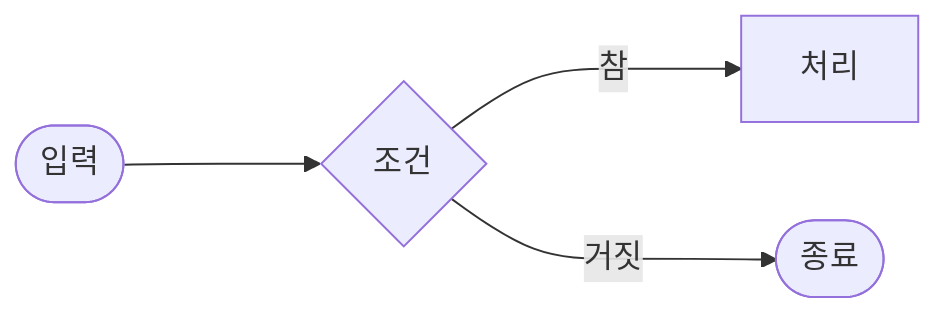
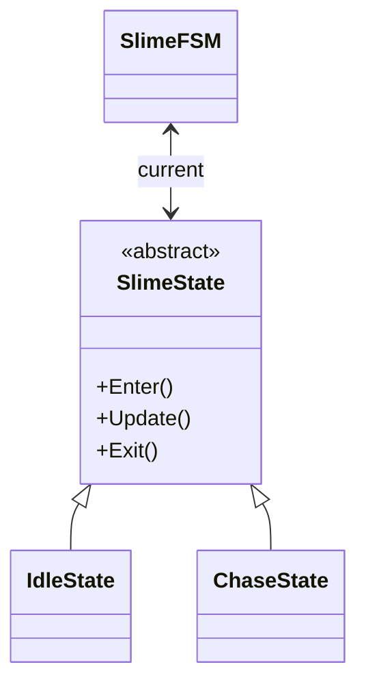
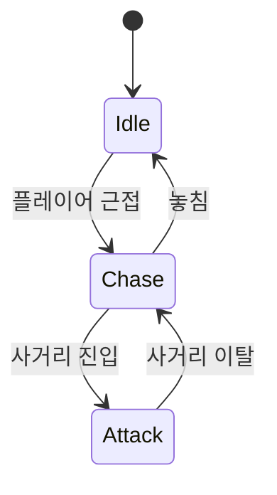
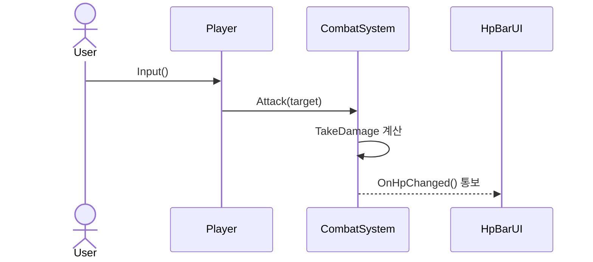
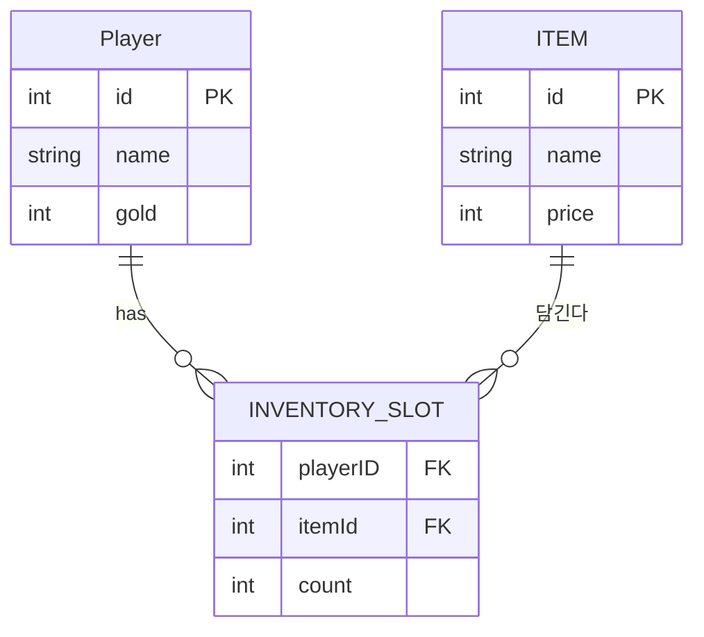

# Mermaid

## Mermaid란?
텍스트(코드)로 다이어그램을 그리는 도구. 마우스로 도형을 끌어다 그리는 대신,
간단한 문법을 마크다운 안에 적으면 그림이 자동으로 그려집니다.

- 순서도(floawchart), 클래스 다이어그램, 상태 다이어그램, 시퀀스 다이어그램, ER 다이어그램
- 코드라서 Git으로 관리, 비교가 되고 수정이 쉽습니다.

## 1. floawchart - (순서도-흐름)

## 2. class diagram - 클래스 다이어그램

## 3. state diagrm - 상태 다이어그램

- '[*]' : 시작/끝 지점
- `상태A --> 상태B : 전이 조건` : 상태 전이를 화살표로

## 4. sequenceDiagram - 시퀀스 다이어 그램

- `actor 별칭 as 이름` : 유저 or 플레이어 선언
- `participant 별칭 as 이름` : 참가자 선언
- `->>` : 호출(실선 화살표), `-->>`: 응답/ 통지(점선)
## 5. erDiagram - ER 다이어그램(데이터 모델 / DB 설계)
엔티티(테이블)와 그들 사이의 관계를 그린다.
"테이블의 한 행 = 객체" 라고 봐도 무방함.

